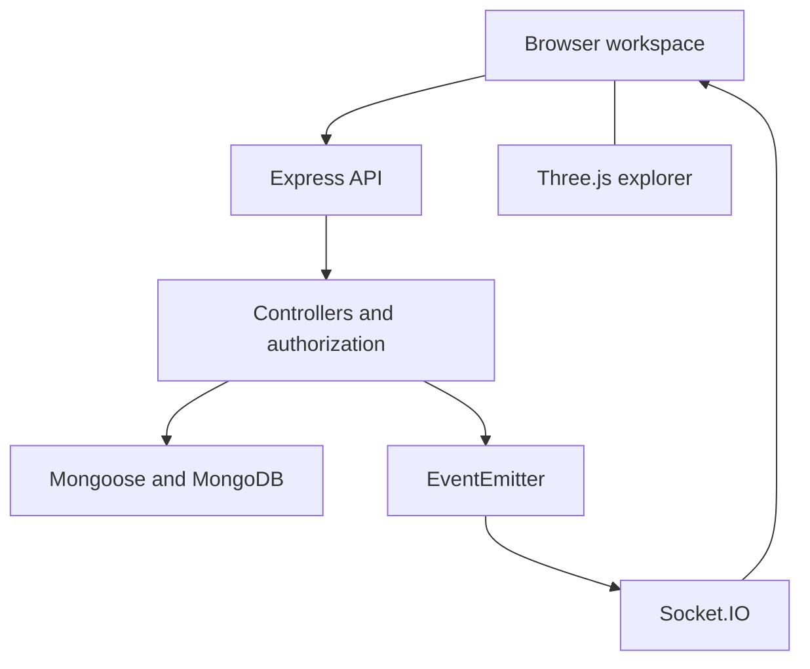

# Architecture

React renders the authenticated workspace or a separate browser-local sample state. The API and Socket.IO share the same HTTP server. JWT sessions establish identity, while controller queries derive visibility from current enrolments and assignments. The API returns scoped data even if interface controls are bypassed.

An attendance session embeds its roster and marks in one document. A unique index detects duplicate class sessions. Corrections atomically update marks, revision and the audit entry. The single-process backend serializes academic writes that span collections, including reference validation followed by deletion, to avoid races between its requests. Running multiple API replicas would require moving cross-document guards into database transactions with coordinated writes.

Announcement and attendance events fire after database writes. Socket notifications carry an empty payload and use the latest scopes to determine recipients. REST is the source of truth on connect and refresh.
