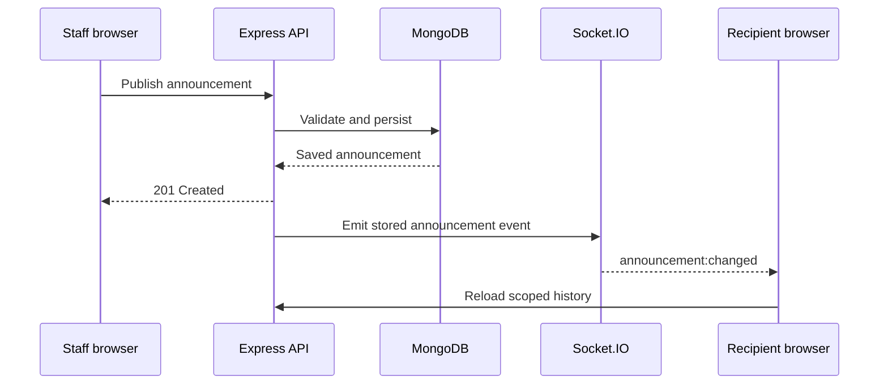

# Real-time updates

The Socket.IO handshake verifies the access token and underlying session. Sockets join server-assigned user and session rooms. Before sending an invalidation, the server checks current audience membership and active sessions. A university announcement can update all active accounts. Other audiences and attendance are limited to authorized recipients. Event payloads are empty, and the recipient reloads authorized REST resources.

Access token expiry disconnects the socket, and logout disconnects its session. On reconnect the frontend retrieves missed changes through REST.
